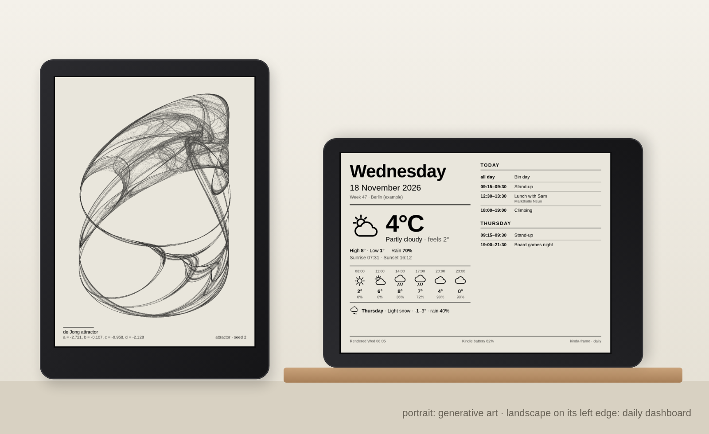
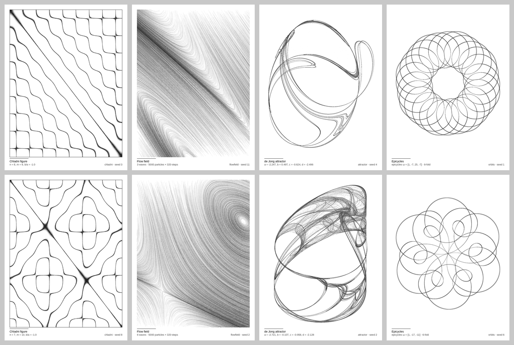
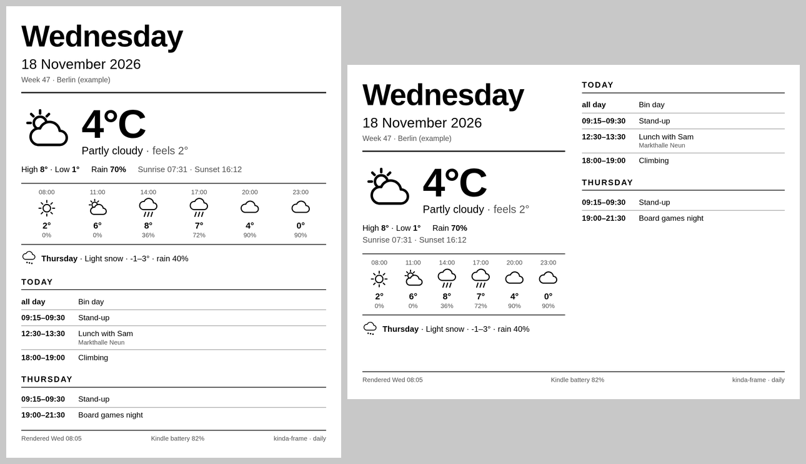
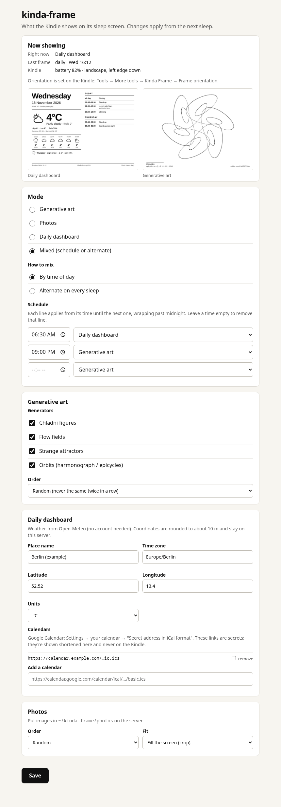

# kinda-frame

Turn a jailbroken Kindle Paperwhite 4 into a picture frame that is still a reader: every time you put it to sleep from KOReader, the sleep screen shows a fresh frame rendered by a small server on your home network: generative art, your photos, or a daily dashboard.



## How it works

- **`plugin/kindaframe.koplugin`**: a KOReader plugin. When the device goes to sleep, KOReader shows the last frame immediately. The plugin then brings Wi-Fi up quietly, downloads a new frame in a child process, checks it, and swaps it into the sleep screen before the Kindle suspends (~60 s window). Waking up mid-fetch cancels everything. Wi-Fi is always left as it was found.
- **`server/`**: a FastAPI renderer in Docker. It serves 16-grey PNGs at the exact screen size, in portrait or landscape:
  - **art**: four original generators (Chladni figures, flow fields, strange attractors, harmonograph/epicycle orbits). See [docs/art.md](docs/art.md).
  - **photo**: images from a folder, fitted and dithered.
  - **dashboard**: a daily board (date, Open-Meteo weather, ICS calendars, Kindle battery) rendered by headless Chromium.
  - **mixed**: by time of day or alternating.
  - A LAN settings page at `/settings` to change all of this, with previews.

## What it shows

**Generative art**: a new piece on every sleep, with a caption giving the parameters and seed so you can re-render one you like ([docs/art.md](docs/art.md)).



**Daily dashboard**: date, weather now/hourly/tomorrow, today's and tomorrow's agenda, Kindle battery. One template lays out for portrait or landscape (example data).



**Settings page**: `http://<server>:8787/settings` on your home network: mode and schedule, art generators, place and calendars, photos, with live previews.



The images are regenerated by [`server/scripts/readme_images.py`](server/scripts/readme_images.py) from the real rendering code, using example data only.

## Docs

| | |
|---|---|
| [SPEC.md](SPEC.md) | The project spec: device facts, decisions, safety rules, phases |
| [specs/001-sleep-screen-frame/](specs/001-sleep-screen-frame/) | Feature spec, plan, research, data model, [frame API contract](specs/001-sleep-screen-frame/contracts/frame-api.md), [quickstart](specs/001-sleep-screen-frame/quickstart.md) |
| [docs/device-probe.md](docs/device-probe.md) | What was measured on the device (firmware, timings, Wi-Fi, redraw) |
| [docs/restore.md](docs/restore.md) | How to undo it |

## Tests

```sh
cd plugin/kindaframe.koplugin && luajit spec/run.lua   # 51 tests, incl. main.lua against stubbed KOReader
cd server && uv run pytest                              # 105 tests (Chromium tests skip if not installed)
```

## Requirements and caveats

- A jailbroken Kindle with KOReader (tested: PW4, FW 5.18.1 hard-float, KOReader v2026.07.2). KOReader must draw its own sleep screen, which it doesn't on ad-supported devices whose framework loads `ad_screensaver` (see research R0).
- The server is meant for a home LAN: plain HTTP, no authentication on the frame or the settings page.
- Not affiliated with Amazon or KOReader.
