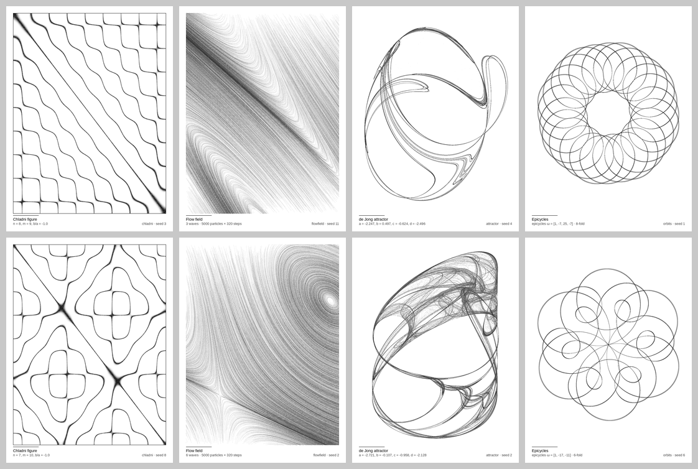

# Art mode: generative pieces for the sleep screen



`mode = "art"` makes the server render a **new piece for every sleep**. The pieces are computed from maths and physics rather than drawn, and laid out like a print: art on white paper, plus a small caption with the title, the parameters and `generator · seed`.

## Where the idea comes from

The inspiration is [Blackbody](https://alistair-roberts.co.uk/blackbody) by Alistair Roberts: OLED wallpapers rendered in code from real data and simulations (Kármán vortex streets, convection, orbits, whale song). Blackbody is made for **OLED**: pure-black backgrounds and less than 3 % of pixels lit, because dark OLED pixels draw no power.

E-ink is the opposite medium. White paper is the natural background, and the panel draws power only when it changes, not for what it shows. So these pieces are **dark linework on white**.

**No Blackbody code or images are used.** Blackbody is CC BY-NC-ND 4.0, which forbids sharing adapted versions. Everything here is original code in `server/kindaframe/art/`.

## The generators

All four are pure functions `render(rng, w, h) -> Piece` (`server/kindaframe/art/*.py`). Each seed draws its parameters from `numpy.random.default_rng(seed)`, so **the same seed always gives the same image**. Render times are measured at 1072×1448 on the dev laptop; the i3 server takes about 2× as long. The server pre-renders the next frame in the background, so the Kindle normally gets an answer in about 30 ms.

| Generator | Draws | Typical render |
|---|---|---|
| `chladni` | Sand on a vibrating plate | 0.2 s |
| `flowfield` | Ink carried by a swirling flow | 0.4 s |
| `attractor` | The shape of a chaotic map | 0.5 s |
| `orbits` | Pendulum and epicycle traces | 0.3–0.4 s |

### `chladni`: Chladni figures

When a plate vibrates, sand collects on the **nodal lines**, the places that don't move. For a square plate in a superposition of two modes:

```
z(x, y) = a·cos(nπx)·cos(mπy) + b·cos(mπx)·cos(nπy),   x, y ∈ [0, 1]
```

- **Parameters:** `n` (1–9), `m` (`n+1` to `n+7`), and `b/a`, usually −1 (the classic symmetric figures), sometimes −0.8 or +1.
- **Rendering:** sand density is `exp(−(z/ε)²)` with ε = 0.06, so lines are thin where the plate moves fast and broaden near saddle points. A little random grain makes it read as sand, and a thin outline marks the plate edge.

### `flowfield`: particles in a curl-noise flow

A stream function made of a few random plane waves:

```
ψ(x, y) = Σ_k a_k·sin(k_k·(x, y) + φ_k)         velocity v = (∂ψ/∂y, −∂ψ/∂x)
```

- **Why it looks like ink in water:** the velocity is divergence-free, so streamlines never pile up into sinks. The result looks like marbled paper.
- **Parameters:** 3–6 waves (wave number 1.5–5, random direction and phase).
- **Rendering:** 5000 particles are advected for 320 Euler steps at **unit speed**, so line density stays even wherever the field is weak. Every position is accumulated into a density image, then log tone-mapped.

### `attractor`: strange attractors

Two classic 2-D chaotic maps:

```
Clifford:  x' = sin(a·y) + c·cos(a·x)      y' = sin(b·x) + d·cos(b·y)
de Jong:   x' = sin(a·y) − cos(b·x)        y' = sin(c·x) − cos(d·y)
```

- **Parameters:** `(a, b, c, d)` from a curated list (6 Clifford, 5 de Jong), each jittered by σ = 0.04.
- **Rendering:** 24 000 walkers iterate in parallel for 220 steps. The first 20 steps are discarded as the transient, leaving about 4.8 M points. The point cloud is turned so its long axis runs down the portrait screen.
- **Quality check:** a draw that collapses to a few points or floods the frame (ink coverage outside 4–75 %) is rejected and redrawn, up to 6 times.

### `orbits`: harmonograph and epicycles

Either of two pen-plotter classics, 50/50:

- **Harmonograph**: a pen moved by damped pendulums, two per axis:
  ```
  x(t) = A₁·sin(f₁t + p₁)·e^(−d₁t) + A₂·sin(f₂t + p₂)·e^(−d₂t)        (same form for y)
  ```
  The frequencies are near a small whole-number ratio (2:3, 3:4, 1:2, 3:5, 2:5, 4:5, 1:3) with a slight detune, so the figure spirals inward as the pendulums lose energy. It's sampled at 2.4 M points.
- **Epicycles**: circles riding on circles (Ptolemy's deferent and epicycles):
  ```
  z(t) = Σ r_k·e^(i(ω_k t + φ_k)),    ω_k integers
  ```
  The frequency differences are multiples of a symmetry number from 3 to 9, so the curve closes into a 3- to 9-fold rosette. It's drawn as three slightly scaled passes, so the line has some weight.

## Portrait and landscape

With *Frame orientation* set to landscape in the plugin, the server renders on a 1448×1072 canvas and turns it into the buffer (`imaging/orient.py`). Margins and type scale by the short side, so both orientations look alike. `attractor` and `orbits` turn their point cloud so its long axis runs along the frame's long side (`align` in `art/base.py`).

## Shared pipeline (`art/base.py`)

1. **Accumulate:** point clouds become per-pixel counts with `np.bincount`, about 10× faster than `np.add.at`.
2. **Tone-map:** `paper = 1 − 0.97·(log1p(d) / max)^γ`, with γ between 0.42 and 0.5. Empty pixels stay pure white.
3. **Compose:** margins of `w/24`, the art area, then a caption: a short rule, the title, the parameters, and `generator · seed` aligned right.
4. **Quantize:** the art is dithered (Floyd–Steinberg) to the 16 device greys. The caption is drawn afterwards and snapped *without* dithering, so the text stays crisp. Every pixel ends up in `{0, 17, …, 255}`; the tests check this.

## Using it

- **Settings** (`server/config.toml`):
  ```toml
  mode = "art"
  [art]
  generators = ["chladni", "flowfield", "attractor", "orbits"]   # any subset
  order = "random"   # never the same generator twice in a row; or "cycle"
  ```
- **Re-render a piece you liked:** use the seed from its caption, e.g. `http://<server>:8787/frame.png?w=1072&h=1448&art=chladni&seed=8`. A request with `art` or `seed` bypasses the pre-render cache.
- **Add a generator:**
  1. Add `art/<name>.py` with `render(rng, w, h) -> Piece`.
  2. Register it in `art/__init__.py` and `config.ALL_GENERATORS`.
  3. The parametrised tests in `server/tests/test_art.py` then check it automatically: size, ink coverage between 1 % and 90 %, determinism per seed, and speed.
